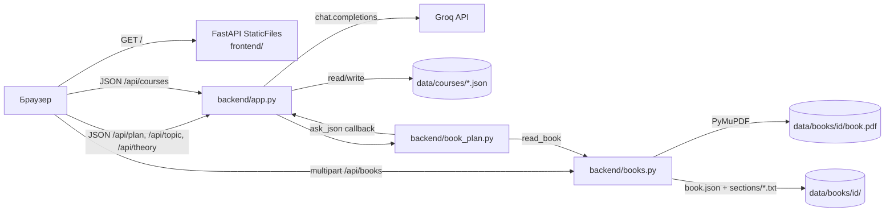

# Архитектура TutorAI

## Назначение и границы

TutorAI — однопользовательское веб-приложение (по фактической реализации), которое по цели обучения генерирует структурированный план курса, разбивает темы на модули и пишет учебный текст с формулами. Дополнительный режим — построить план по оглавлению загруженного PDF-учебника.

В границах системы: UI, REST API, вызовы Groq LLM, парсинг PDF и локальное файловое хранилище. Вне границ: аутентификация, биллинг, БД, фоновые задачи, очередь, мультитенантность, офлайн-режим. Всё это отсутствует, а не вынесено наружу.

## Диаграмма

Поток данных: браузер → FastAPI → Groq → JSON/Markdown → браузер. Курсы и книги сохраняются на диск без БД и без транзакций.

## Ключевые сценарии

### 1. План с ИИ и теория модуля
1. `POST /api/plan` с `{goal, level}` → `ask_json(PLAN_PROMPT)` → JSON `{size, scope, prerequisites, topics}`.
2. Пользователь нажимает «Разбить на модули» → `POST /api/topic` с темой и списком тем → JSON `{modules}`; `kind`/`also` нормализуются по `KINDS`.
3. Открытие модуля → `POST /api/theory` → системный промпт = `THEORY_COMMON` + `KIND_PROMPTS[kind]` (опционально второй тип) → Markdown.
4. `POST /api/courses` сохраняет весь план; `PUT /api/courses/{id}` дописывает модули/теорию при каждом изменении.
5. Фронтенд рендерит Markdown через marked, очищает DOMPurify, формулы подставляет KaTeX.

### 2. Курс по учебнику
1. `POST /api/books` принимает PDF, читает его целиком в память, проверяет текстовый слой первых 10 страниц, сохраняет `book.pdf`.
2. Оглавление берётся из закладок (`get_toc`) либо парсится с указанных страниц по regex с группами `title`/`page`; диапазоны страниц считает `add_ranges`.
3. `POST /api/plan/book` → `build_book_plan`: два прохода LLM (главы, затем подразделы), результат — темы с модулями и ссылками на страницы PDF.
4. `GET /api/books/{id}/sections/{n}` отдаёт кэшированный текст раздела (`sections/n.txt`) или извлекает его PyMuPDF.

### 3. Сохранение и повторное открытие
`GET /api/courses` читает все JSON, сортирует по mtime и возвращает сводку; `GET /api/courses/{id}` — полный курс. При открытии сохранённого курса новые модули/теория автоматически уходят в `PUT`.

## Модули

| Модуль | Ответственность | Файлы |
|---|---|---|
| API-приложение | Роуты плана/темы/теории/курсов, промпты, LLM-клиент, раздача статики | `backend/app.py` |
| PDF и оглавление | Загрузка PDF, извлечение/парсинг TOC, кэш текста разделов | `backend/books.py` |
| План по книге | Выбор глав и подразделов LLM, сборка структуры курса | `backend/book_plan.py` |
| UI-оркестратор | Состояние `current`, режимы, сохранение, гонки ответов через `viewId` | `frontend/js/app.js` |
| HTTP-клиент | Обёртка `fetch`, JSON-ошибки | `frontend/js/api.js`, `frontend/js/books.js` |
| Рендеринг | План, сохранённые курсы, экран модуля, Markdown/LaTeX | `frontend/js/views.js` |
| Разметка и стили | Единственная страница, адаптивная тёмная/светлая тема | `frontend/index.html`, `frontend/css/style.css` |
| Данные | Курсы и книги (файловое хранилище) | `data/courses/`, `data/books/` |

Между `app.py` и `books.py` есть слабая связность: `book_plan.py` импортирует `read_book` из `books.py`, а `_pick` получает `ask_json` как callback из `app.py` — это смягчает цикл, но доменная логика размазана по слоям.

## Внешние зависимости

| Зависимость | Роль | Риск |
|---|---|---|
| Groq API (`groq`) | Генерация плана/модулей/теории, модель `openai/gpt-oss-120b` по умолчанию | Сетевой сбой, лимиты, стоимость, приватность введённых целей |
| PyMuPDF (`fitz`) | Чтение PDF и закладок | **Не указан в `requirements.txt`**; тяжёлая нативная зависимость |
| python-multipart | Разбор `UploadFile`/`Form` | **Не указан**; без него загрузка падает |
| marked, DOMPurify, KaTeX | Markdown, XSS-очистка, формулы | CDN без SRI и без локальной копии |
| pypdf | Не используется | Лишняя зависимость |
| Файловая система | Единственное хранилище | Нет блокировок, атомарности, бэкапов |

## Архитектурный долг

1. **Секрет в репозитории** (`.env:1`) — ключ Groq в git; требуется ротация и очистка истории. PLAN P0-2.
2. **Ломающая установка** — `requirements.txt:1-4` не содержит `pymupdf` и `python-multipart`, версии не зафиксированы. PLAN P0-1.
3. **Нет аутентификации и квот** — любой, кто достучался до порта, тратит ключ и пишет на диск. PLAN P0-3.
4. **Монолитный `app.py`** — роуты, промпты и клиент в одном модуле; глобальный `Groq` создаётся при импорте (`app.py:17`). PLAN P1-1.
5. **Небезопасная работа с файлами** — PDF читается целиком без лимита (`books.py:117`), документы PyMuPDF не закрываются (`books.py:148,177,194`), запись JSON неатомарна (`app.py:229`, `books.py:34`). PLAN P0-4, P1-2.
6. **Слабая валидация** — `Course.plan` — произвольный `dict` (`app.py:124`), ответы LLM проверяются частично (`book_plan.py:28-38`), пустой TOC даёт 500 (`book_plan.py:71`). PLAN P1-3.
7. **Утечка деталей ошибок** — текст исключения LLM уходит клиенту (`app.py:147-148`). PLAN P0-5.
8. **Фронтенд без устойчивости** — нет таймаутов (`api.js:1-6`), CDN без SRI (`views.js:1-3`), возможен краш на литерале `ZZMATH0ZZ` (`views.js:180`). PLAN P1-5, P2-2.
9. **Нет тестов, CI, линтеров, README** — регрессии ловятся вручную. PLAN P1-4, P2-1.
10. **Данные в git** — `data/books/*.pdf` (8 МБ), курсы, `__pycache__`; нет `.gitignore`. PLAN P0-6.
